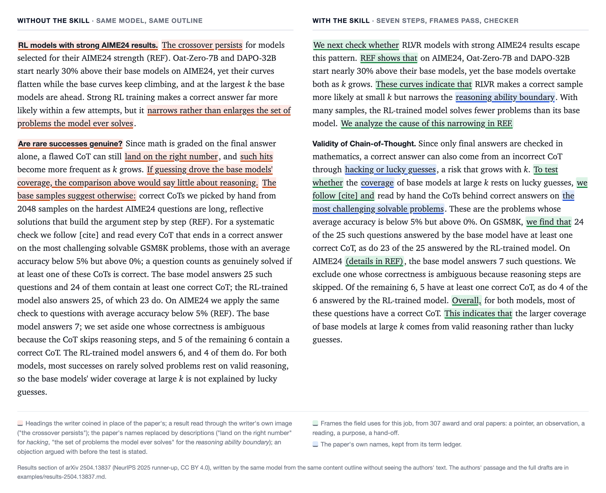

# ml-paper-humanizer

**专为机器学习顶会论文打造的英文写作与润色 Agent Skill（适配 Claude Code、Codex 及主流 AI 编程助手）——去 AI 味，让正文读起来像人写的。**

[English](README.md) · [完整示例](examples/results-2504.13837.md)

---

## 亮点

直接使用大模型起草或润色论文，往往会产生浮夸的修辞、冗余的逻辑连接词以及生造的学术短语。`ml-paper-humanizer` 不依赖简单的“禁用词表”，而是通过**顶会语料约束、经典修辞法则、领域术语对齐**三个底层机制，配合可选的外部模型（如 Gemini）受控字句润色，系统性重建模型的学术写作能力。

### 1. 基于 307 篇顶会获奖与 Oral 论文的语料实证
我们对 2023–2026 年间 **NeurIPS、ICML、ICLR、ACL、CVPR** 等 12 个顶会的全部获奖及 Oral 论文（共 307 篇）进行了语料库分析，按句子功能（引出图表、汇报结果、基线对比、界定范围、陈述方法等）提取出 1,234 条高频学术句式（每条均在至少 6 篇独立论文中复现）。
* **实证发现：** 将 60 段发表原文与 318 段模型生成稿逐一对照统计后，我们发现模型稿缺失的“学术感”，核心在于未能掌握这套标准功能句式。
* **实际效果：** 确保生成的文本严格落入审稿人最熟悉的顶会修辞习惯中，消除大模型自创的怪异表达。

### 2. 融合七部经典学术写作指南的句法重构
良好的学术文风不仅在于剔除 AI 常见词，更取决于信息在句子内部的组织方式。我们将 Gopen & Swan《The Science of Scientific Writing》、Williams《Style》、Swales & Feak《Academic Writing for Graduate Students》、Strunk《The Elements of Style》等七部权威指南的核心原则，转化为模型在生成与回读阶段的硬性校验指标：
* **信息流控制：** 新信息置于句末（Stress position），主语紧邻谓语，核心动作用强动词而非名词化结构表达。
* **逻辑与克制：** 转折提前标记；语序本身能体现逻辑时绝不堆砌连接词；严格执行“一物一名”与并列同形。
* **主张与证据对齐：** 对 Reporting verbs 进行强度分级，让步逻辑压缩至单个从句，确保结论的语气强度与实验证据严格匹配。
* **实际效果：** 这些是读者不会刻意留意、但直接决定阅读流畅度的底层技巧。模型无法自发习得，由本 Skill 在写时控制、读回时审查。

### 3. 子领域术语对齐与事实边界锁死
通用的“去 AI 味”工具常通过同义词替换来规避检测（例如将具体的模型架构名泛化为“该模型”或“所提出的系统”），这在专业审稿人眼中会立即暴露外行痕迹。
* **术语提取与对齐：** 自动从当前正文及引用文献中提取子领域的既定术语，建立经逐字核验的术语表，全篇贯彻“一物一名”。
* **事实红线：** 实验数值、模型与数据集名称、LaTeX 引用标签及已定义术语**一律锁死不改**（存疑数据仅做标记提示），确保语言润色绝不越界干扰科学事实。

### 4. 可选的 Gemini 字句润色与逐句差分审查
实验表明，若让外部模型直接根据提纲起草章节，往往会凭空添加提纲之外的限定词与实质内容，质量反而不及本 Skill 的初稿；但若将其严格限制在“完稿后的字句微调”，则在盲评中提升了文风表现。在 `write` 模式下，用户可按需调用任意兼容 OpenAI 接口的外部模型（配套纯 Python 零依赖脚本，已通过 `gemini-4-argon` 测试）执行第八步字句润色。
* **严格的分工边界：** 主 Agent（Claude）负责完成第 1–7 步的起草与校验；外部模型随后接收初稿及本 Skill 裁切出的读者需求、主张强度阶梯、例句库与顶会范文，仅被允许在保持段落结构、主张动词与范围、数值、引用及限定词完全不变的前提下优化字句表达。
* **脚本自动回退与逐条复核：** `scripts/revise_check.py` 会将初稿与润色稿逐句对齐——若发现段落被合并、拆分或移动则整篇丢弃；若数值、引用、交叉引用、数学公式、标题、粗体标签或提纲中的“Keep”项被改动则自动回退。脚本随后将其余改动（并标记术语频次下降、新增 *"significantly"* 或 *"across"* 等强度/范围词、句子拆分合并等风险项）汇总为变更清单。Claude 仅需读取该清单（同会话下约增加 20k tokens，即约 13% 的额外开销），将改变主张范围、把解读变成事实或打破“一物一名”的修改逐一退回（每节 13–28 处改动中约半数会被退回），最后重跑终检脚本。
* **实际效果：** 在基于三篇已发表论文 Introduction 与 Results 章节的盲评中（由不知晓文本来源的 GPT、Gemini 和 Claude 担任评委），经此步润色后的文本在 8 次写作质量评判中有 7 次优于润色前初稿，在 8 次原文贴近度评判中全部更接近发表原文（在更早一轮对比中，也在 12 次质量评判的 9 次、12 次贴近度评判的 11 次中胜过仅用本 Skill 的版本）。由于该步骤会将章节草稿与提纲发送至用户配置的外部服务，除非用户明确要求，否则绝不会自动运行。

---

## 使用 Skill 前后对照

以下为 NeurIPS 2025 runner-up 论文（[arXiv 2504.13837](https://arxiv.org/abs/2504.13837)，CC BY 4.0）实验章节中的两段。同一模型按同一份内容提纲写了两次，均未见过发表原文。

<picture>
  <source media="(prefers-color-scheme: dark)" srcset="examples/compare-dark.png">
  
</picture>

* **不用 Skill（左）：** 模型自拟小标题，用生造的比喻解读图表（*"the crossover persists"*），实验尚未交代便提前回应审稿质疑，并将论文已命名的概念替换成了泛化描述。
* **使用 Skill（右）：** 每段先交代目的再给数字，用领域标准句式指向图表，严格沿用论文自身的术语（*reasoning ability boundary*、*hacking or lucky guesses*），推论均由恰当的 reporting verb 引出。
* **完整对照：** 两版完整生成稿及发表原文见 [examples/results-2504.13837.md](examples/results-2504.13837.md)。

在句子层面，Skill 内置了 40 组如下的对照教材——针对同一写作任务，对比模型初稿与顶会发表原文的真实差距：

| 写作任务               | 模型初稿 (Model draft)                                       | 顶会发表原文 (Published text)                                |
| ---------------------- | ------------------------------------------------------------ | ------------------------------------------------------------ |
| 说明一个比较为何不公平 | That yardstick, however, measures a different goal.          | This would not be a fair comparison, because LMNet is a general method to improve the intelligence of a given LLM, with additional training cost only less than 1% of the pre-training.（[2505.12741](https://arxiv.org/abs/2505.12741)） |
| 先给问题，再给数字     | Notably, SFT on the same data lowers mean accuracy by 5.7% relative to Prompt. | Second, one may argue that the improvement mainly relies on training data. SFT (implemented by very moderate training configurations) can hardly bring improvement over the pre-trained LLM (-5.7%).（[2505.12741](https://arxiv.org/abs/2505.12741)） |
| 标出意外的结果         | Actual LLMs, shown as gray points in the same panel, follow a similar exponent near 1. | Remarkably, we find that actual LLMs follow a similar scaling.（[2505.10465](https://arxiv.org/abs/2505.10465)） |

---

## 工作原理

### 1. 消除五种写作动作，而非维护禁用词表
论文中的“AI 味”本质上源于模型的五种写作动作：
* **表演（Performing）：** 把一个普通结论包装成深刻洞见。
* **防御（Defending）：** 把本该放在 Rebuttal 里的辩解提前写进正文。
* **堆砌（Piling）：** 将数字、从句、引用全部挤在同一句话中。
* **复述（Restating）：** 小标题、首句、末句和图注反复表达同一个意思。
* **漂移（Drifting）：** 同一个事物换用多个名称，或将内部代号遗留在正文中。

去除这些动作，措辞随之自然。**本 Skill 不设禁用词表：** 我们在测试中发现，硬性词表和句式配额会导致生成稿读起来像刻板模板，因此已将其彻底移除。

### 2. 两种工作模式
* **`rewrite`（默认修改模式）：** 一遍即可读懂的原句予以保留；输出修改后的英文正文及逐条改动清单（改前、改后、修改原因）。
* **`write`（起草模式）：** 根据提纲、笔记或粗稿撰写新段落；论文正文保持英文，可按需附带逐句中文直译。使用中文提问时，Skill 会以中文回复沟通。

### 3. 执行流水线：七步与可选的第八步
`SKILL.md` 对每次请求严格按以下顺序执行：
1. **定取向：** 确定论文类型（proof / effect / design / evaluation / discovery），读取 Playbook 中对应章节的结构框架。
2. **建术语表：** 从当前正文和引用文献中提取并核验领域术语。
3. **读范例：** 检索例句库中即将写到的句法动作；在 `write` 模式下额外精读三段同类顶会范文。
4. **写或改：** 撰写或重写正文，在落笔时同步确立句与句之间的逻辑衔接。
5. **三遍回读：** 一查事实保真，二查术语表一致性，三查权威写作指南的各项句法指标。
6. **句式对齐（Frames Pass）：** `write` 模式必做，`rewrite` 模式按需执行。对照句式库逐句检查，凡涉及指向图表、报告观察、给出解读、基线比较或承上启下的句子，统一替换为领域标准句式。
7. **脚本终检：** 运行检查脚本，以当前文档自身为基准报告异常重复（如同一概念使用了两个名称、段落首尾复述小标题、提及性能提升却未指明比较基准等）。
8. **外部模型字句润色（可选，仅限 `write` 模式）：** 仅在用户明确要求时运行，在第 6 步与第 7 步之后将初稿与提纲发送至用户配置的 OpenAI 兼容接口（已通过 Gemini `gemini-4-argon` 测试）进行纯字句微调。`scripts/revise_check.py` 会自动回退任何针对数值、引用、公式、标题及提纲“Keep”项的改动并生成变更清单；主 Agent 逐条审查该清单，退回任何越界改动主张强度、范围或术语的句子，最后重新运行终检脚本。

### 4. 边界与局限（它不做什么）
* **不针对 AI 检测器：** 本工具未在任何 AI 检测器上测试，也不对检测率作任何承诺；它解决的是**人类审稿人**能读出来的问题。
* **不越界：** 不核验引文真伪，不强制套用特定期刊的排版格式，也不从你过往的论文中学习个人文风。语料覆盖范围为 ML、NLP 与 CV。
* **已知差距：** 使用本工具写出的段落通常仍比发表原文略短，领域特定动词的丰富度也略低（具体差距可在示例文件中查看）。

### 5. 验证方法
仓库中的每一条规则均以同一方式验证：让模型在未见原文的情况下，仅根据获奖论文某一节的大纲起草正文，再将生成稿与发表原文对照阅读；凡未能在对照阅读中展现正向效果的规则，均已被剔除。

---

## 配套 Skill：`ml-paper-outliner`

润色能守住措辞，却守不住底稿里从未写明的那一步论证。[`ml-paper-outliner/`](ml-paper-outliner/SKILL.md) 是本仓库里的第二个 Skill，往下一层工作：它只写论文的**骨架**，即一句话的贡献、论文取向，以及每段一行——这段回答什么问题、主张是什么（含 reporting verb）、证据在哪、交给下一段什么。输入可以是笔记、提纲，也可以是已有草稿（做反向大纲）；它不写论文正文。

骨架是两个 Skill 之间唯一的合同。`ml-paper-humanizer` 在 `write` 模式下以它为提纲，在 `rewrite` 模式下拿它核对改稿：每段的那一行都还在、没有多出主张、reporting verb 没有上调或下调。格式与完整示例见 [ml-paper-outliner/references/skeleton.md](ml-paper-outliner/references/skeleton.md)。两个 Skill 共用 `section-playbook.md` 与 `claim-strength.md`，outliner 从上级目录读取，只维护一份。

* `"先别动措辞，把我 introduction 的逻辑理顺。这是我的笔记。"`
* `"给这节 results 做个反向大纲，告诉我论证在哪断了。"`
* `"/ml-paper-outliner sec/method.tex"`

---

## 安装与使用

### 安装 Skill

**Claude Code：**
```bash
git clone https://github.com/Fwibo/ml-paper-humanizer ~/.claude/skills/ml-paper-humanizer
ln -s ~/.claude/skills/ml-paper-humanizer/ml-paper-outliner ~/.claude/skills/ml-paper-outliner
```

**Codex CLI：**
```bash
git clone https://github.com/Fwibo/ml-paper-humanizer ~/.codex/skills/ml-paper-humanizer
ln -s ~/.codex/skills/ml-paper-humanizer/ml-paper-outliner ~/.codex/skills/ml-paper-outliner
```

* **其他 AI Coding Agent：** 凡支持加载 Agent Skills（即读取含 `SKILL.md` 的目录）的工具，可直接指向同一文件夹。上面第二行把配套 Skill `ml-paper-outliner` 链接为独立 Skill；会扫描子目录的工具不需要这一步。
* **claude.ai 网页版：** 将本仓库文件夹整体打包为一个 `.zip`，在 `Settings → Capabilities → Skills` 中上传即可。配套 Skill 在文件夹内，由 `SKILL.md` 指向；不要单独上传 `ml-paper-outliner/`，它要从上级目录读两份参考文件。

### 环境依赖

基础检查脚本与范文抽取仅需 **Python 3**。若需使用自动术语候选提取（依赖 `spaCy`）及引用 PDF 解析（依赖 `PyMuPDF`），请安装可选依赖（未安装时，术语表将由模型提取并交由脚本逐字核验）：

```bash
pip install spacy pymupdf && python -m spacy download en_core_web_sm
```

可选的 Gemini 字句润色无需安装 SDK，只需一个 OpenAI 兼容接口，通过 `HUMANIZER_LLM_BASE_URL`、`HUMANIZER_LLM_API_KEY` 与 `HUMANIZER_LLM_MODEL` 配置。

### 触发示例

用自然语言（中文或英文）直接提出写作、修改或诊断请求即可触发：

* `"把 results 第二段改一下，读着像 AI 写的。"`
* `"按这些笔记写 introduction，这是一篇 discovery 类的论文。"`
* `"这个摘要太防御了，改一下。"`
* `"先别改，告诉我这一节哪里有问题。"`
* `"/ml-paper-humanizer sec/experiments.tex"`
* `"按这个提纲写 results 这一节，并跑一下 Gemini 字句润色。"`

配套工具脚本也可在命令行下独立运行：

```bash
# 运行文档级异常重复与结构检查
python scripts/check_tex.py paper/ --ledger ledger.json

# 从 LaTeX 源码及引用 PDF 中提取并核验术语表
python scripts/term_ledger.py paper/main.tex --cited refs/*.pdf --out ledger.json

# 按章节类型与论文取向抽取三段顶会范文
python scripts/pick_exemplars.py results --orientation discovery

# 运行可选的外部模型字句润色，输出 final.md 与差异清单 final.changes.md
export HUMANIZER_LLM_BASE_URL="https://your-openai-compatible-endpoint/v1"
export HUMANIZER_LLM_API_KEY="your-api-key"
export HUMANIZER_LLM_MODEL="gemini-4-argon"
python scripts/external_draft.py results --skeleton skeleton.md --names ledger.json --orientation discovery --revise draft.md --out final.md
```

---

## 仓库结构

```text
SKILL.md                      核心指令：七步工作流与可选的第 8 步字句润色、读者需求、回读核查表与输出契约
references/
  section-playbook.md         按论文取向划分的各章节（从 Abstract 到 Rebuttal）写作任务框架
  sentence-bank.md            40 组模型初稿与顶会原文的病句对照（按问题分类）及 23 句动作范例
  register-frames.md          1,234 条按句子功能分类的顶会高频句式（附出现篇数统计）
  connectives.md              权威写作指南要点，以及因果、对比、让步的标准表达形式
  claim-strength.md           Reporting verb 强度分级表，区分设计意图与实验结果
  exemplars/                  取自 30 篇顶会论文的 144 段引言与实验范文，附 SOURCES.md
scripts/
  check_tex.py                基于文档自身分布的无阈值重复与结构检查脚本（.tex 或 .md）
  term_ledger.py              从正文与引用 PDF 提取术语候选；--verify 仅保留逐字匹配的术语
  pick_exemplars.py           按章节类型和论文取向抽取三段参考范文
  external_draft.py           第 8 步：调用 OpenAI 兼容接口的模型做字句润色（--revise），并运行差分检查
  revise_check.py             逐句对齐初稿与润色稿，自动回退受保护的改动，其余列为待审清单
examples/
  results-2504.13837.md       完整实验章节对比：不用 Skill、使用 Skill 与发表原文
  compare.html, compare*.png  README 顶部的对比图及用于渲染该图的 HTML 源码
ml-paper-outliner/            配套 Skill：论证骨架，动笔前写出，或从草稿反向抽出
  SKILL.md                    两种模式（skeleton、reverse）、论证欠读者什么、论证链核查
  references/skeleton.md      骨架格式、humanizer 据此核对什么、以及一个完整示例
  references/*.md             指向上面 section-playbook.md 与 claim-strength.md 的链接，两个 Skill 共用
```

---

## 来源与许可

* **代码与规则许可：** 本 Skill 自身（含 `SKILL.md`、各类脚本及为此编写的参考规则文件）基于 **MIT License** 开源，详见 `LICENSE`。
* **语料与范文版权：** 范文库（`references/exemplars/`）收录的 30 篇论文短节选均遵循 **CC BY 4.0** 或 **CC0 1.0** 协议，具体来源与许可详见 `references/exemplars/SOURCES.md`。例句库（`sentence-bank.md`）引用的获奖论文单句均在文末 Sources 章节列出了原论文及许可。所有引文版权归原作者所有。节选中的文献引用与交叉引用已脱敏替换为 `[cite]` 和 `REF`，且 Skill 明确限制模型严禁复用范文中的实质内容或任何连续六个词以上的原文片段。句式表与连接词表仅包含短语结构与统计计数。
* **致谢：** “围绕论文实际成果行文，而非围绕每一条潜在审稿质疑做防御”的理念启发自 [anti-defensive-writing-Skill](https://github.com/Adkid-Zephyr/anti-defensive-writing-Skill)（MIT）。此外，[humanizer](https://github.com/blader/humanizer) 致力于依据维基百科总结的“AI 写作特征”洗掉通用文本的 AI 痕迹；而本仓库仅专注于 **ML 学术论文**，且所有规则均直接从顶会论文本身提炼而来。
